  

  
  
  
  
  

---

## 👋 About Me

**Full-Stack Developer & Technical Project Manager** · Exploring **AI automation** for scalable web solutions

I'm a full-stack developer from Rangpur, Bangladesh, with **2+ years of professional experience** taking web and mobile products from idea to production. I write the code, and I also plan the work, break it into deliverables, and keep a team shipping on time.

I work with **React, Next.js and TypeScript** on the front end, **React Native with Expo** for mobile, and **Node.js and Express** over **PostgreSQL** or **MongoDB** on the back end, and I deploy and manage apps on **VPS** servers. Right now I'm focused on **AI automation**: using **n8n**, LLM APIs and AI-assisted workflows to make products smarter and teams faster.

<table>
  <tr>
    <td width="50%" valign="top">
      <h4>🧭 Product &amp; Delivery</h4>
      <ul>
        <li>Turn business goals into scoped features and roadmaps</li>
        <li>Plan sprints, break down tasks, track delivery</li>
        <li>Code reviews and a clean Git workflow</li>
        <li>Work with clients and stakeholders through to launch</li>
      </ul>
    </td>
    <td width="50%" valign="top">
      <h4>🤖 AI, Automation &amp; DevOps</h4>
      <ul>
        <li>LLM-powered features with the Gemini API</li>
        <li>AI-assisted development and agent workflows</li>
        <li>Workflow automation with n8n</li>
        <li>Deploying and running apps on my own VPS</li>
      </ul>
    </td>
  </tr>
</table>

| | How I build |
|---|---|
| 🔒 **Type-safe** | TypeScript end to end, from database schema to API contract to UI |
| 🧪 **Tested** | Meaningful unit and E2E coverage over vanity percentages |
| ⚡ **Fast** | Rendering strategy, bundle size, query patterns, Core Web Vitals |
| ♿ **Accessible** | Responsive and verified on real devices, not just a resized browser |
| 🛡️ **Secure** | Sane auth flows, least-privilege data access, no secrets in the client |

---

## 🛠️ Tech Stack

<table>
  <tr>
    <td width="170"><b>Languages</b></td>
    <td>
      
      
      
    </td>
  </tr>
  <tr>
    <td><b>Frontend</b></td>
    <td>
      
      
      
      
      
      
    </td>
  </tr>
  <tr>
    <td><b>Mobile</b></td>
    <td>
      
      
    </td>
  </tr>
  <tr>
    <td><b>Backend</b></td>
    <td>
      
      
      
      
      
    </td>
  </tr>
  <tr>
    <td><b>Databases</b></td>
    <td>
      
      
      
      
    </td>
  </tr>
  <tr>
    <td><b>AI &amp; Automation</b></td>
    <td>
      
      
      
      
    </td>
  </tr>
  <tr>
    <td><b>Testing</b></td>
    <td>
      
      
      
    </td>
  </tr>
  <tr>
    <td><b>DevOps &amp; Tools</b></td>
    <td>
      
      
      
      
      
      
      
    </td>
  </tr>
</table>

---

## 📊 GitHub Activity

  
  

  
  

---

## 🤝 Let's Work Together

I'm open to **full-time roles, contract work and collaborations**. The fastest way to reach me is [LinkedIn](https://linkedin.com/in/arifadnan05), and you can see more of my work on my [portfolio](https://arifadnan.netlify.app).

  

